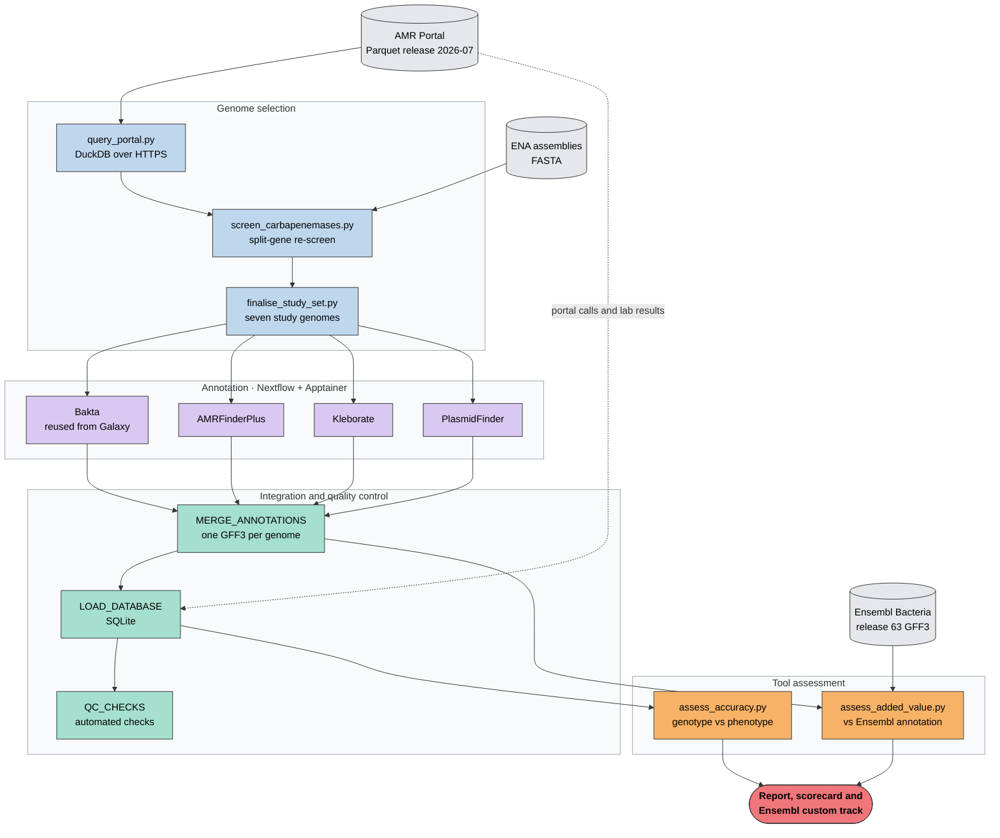

# KlebTrace

**A reproducible annotation and data-integration pipeline for investigating carbapenem resistance in *Klebsiella pneumoniae***

> **Status:** pilot complete on seven genomes (pipeline built to scale to the full EMBL-EBI AMR Portal release).

## Report

Learn more about the findings in the [full report](docs/report.md)

## Overview

*Klebsiella pneumoniae* is a WHO critical-priority pathogen, and carbapenem resistance in this species leaves few treatment options. The [EMBL-EBI AMR Portal](https://www.ebi.ac.uk/amr) links laboratory antimicrobial susceptibility results to genome-based resistance calls for the same isolates.

KlebTrace uses that resource to assess what specialist annotation tools could add to Ensembl's bacterial genomes, with five objectives:

1. **A reproducible pipeline -** Can the annotation be run as a pipeline, and loaded with the portal's calls and laboratory results into a database with automatic quality checks?
2. **Annotation agreement -** Do Bakta, AMRFinderPlus and Kleborate find the same resistance genes as the AMR Portal when they annotate the same genomes?
3. **Enriching Ensembl annotation -** What do specialist tools add to Ensembl's genome annotation, and how could these features be shown in the Ensembl browser?
4. **Genotype and phenotype -** Do the detected genes explain each isolate's laboratory meropenem result, and what explains resistant isolates with no known carbapenemase gene?
5. **Genomic context -** Are carbapenemase genes located on plasmids or on the chromosome?

## Workflow



The annotation was prototyped as a Galaxy workflow (`galaxy/`) and built in Nextflow (`nextflow/`) with the same tool versions, reproducing the Galaxy outputs.

## Repository structure

| Folder | Contents |
|---|---|
| `data/` | Selected isolates (`samples.tsv`) and the portal's resistance calls (`portal_calls.tsv`) |
| `galaxy/` | Galaxy workflow prototype, tool versions and screenshots |
| `nextflow/` | Reproducible Nextflow pipeline |
| `scripts/` | Python scripts for querying, downloading, parsing, comparing and loading |
| `database/` | Database schema and example queries |
| `tests/` | Unit tests and small test inputs |
| `results/` | Summary tables and figures |
| `docs/` | Project report (`report.md`) and tool assessment (`tool_assessment.md`) |

## Quick start

```bash
conda env create -f environment.yml
conda activate klebtrace

# 1. Inspect the AMR Portal Parquet schema (check column names first)
python scripts/query_portal.py --inspect

# 2. Summarise K. pneumoniae meropenem isolates and select six study genomes
python scripts/query_portal.py --outdir data/ \
    --ensembl-list https://ftp.ensemblgenomes.ebi.ac.uk/pub/bacteria/current/species_EnsemblBacteria.txt \
    --prefer-regions Africa

# 3. Download the genomes, re-check the portal-negative isolates for split or
#    partial carbapenemase genes, and add one confirmed negative (seventh genome)
python scripts/download_genomes.py
python scripts/screen_carbapenemases.py --amr-db <Kleborate_AMRdb.csv> --amr-fasta <Kleborate_AMRdb.fasta>
kleborate -a data/screen_genomes/*.fasta -o results/kleborate_negatives \
    -m general__species,general__contig_stats,kpsc__mlst,kpsc__amr
python scripts/finalise_study_set.py --kleborate results/kleborate_negatives/general__species_output.txt
python scripts/download_genomes.py

# 4. Summarise the Galaxy annotation outputs (downloaded to results/phase2_galaxy/)
python scripts/summarise_galaxy_outputs.py

# 5. Run tests
pytest tests/
```

## Future directions

- **One feature per gene for Ensembl:** merge the Bakta and AMRFinderPlus features so that each resistance gene appears once, with its resistance details attached.
- **Beyond resistance:** find biosynthetic gene clusters with antiSMASH and compare them with Kleborate's virulence loci, such as yersiniabactin and aerobactin.
- **Gene function:** summarise gene functions into pathways with eggNOG-mapper, which uses the EggNOG database Ensembl already applies.
- **Confirm split genes:** check split carbapenemase genes with sequencing reads or long-read assemblies.
- **Unresolved resistance:** look for other causes of resistance in GCA_000567225.2, such as efflux pumps or AmpC enzymes.

See the [report](docs/report.md) for the full discussion.

## Data sources

- EMBL-EBI AMR Portal release files: https://ftp.ebi.ac.uk/pub/databases/amr_portal/releases/
- Genome assemblies: European Nucleotide Archive (ENA)

## Author

**Chioma B Oselu**<br>
PhD Researcher, Bioinformatics | Microbial Genomics | Reproducible Pipelines<br>
2025 L'Oréal-UNESCO For Women in Science Laureate (Sub-Saharan Africa)<br>
[LinkedIn](https://www.linkedin.com/in/chioma-onyido/) · [GitHub](https://github.com/Omabekee) · [Google Scholar](https://scholar.google.com/citations?user=OTw33EIAAAAJ)

## Licence

Code is released under the MIT Licence. Data remain subject to the terms of their original sources.
