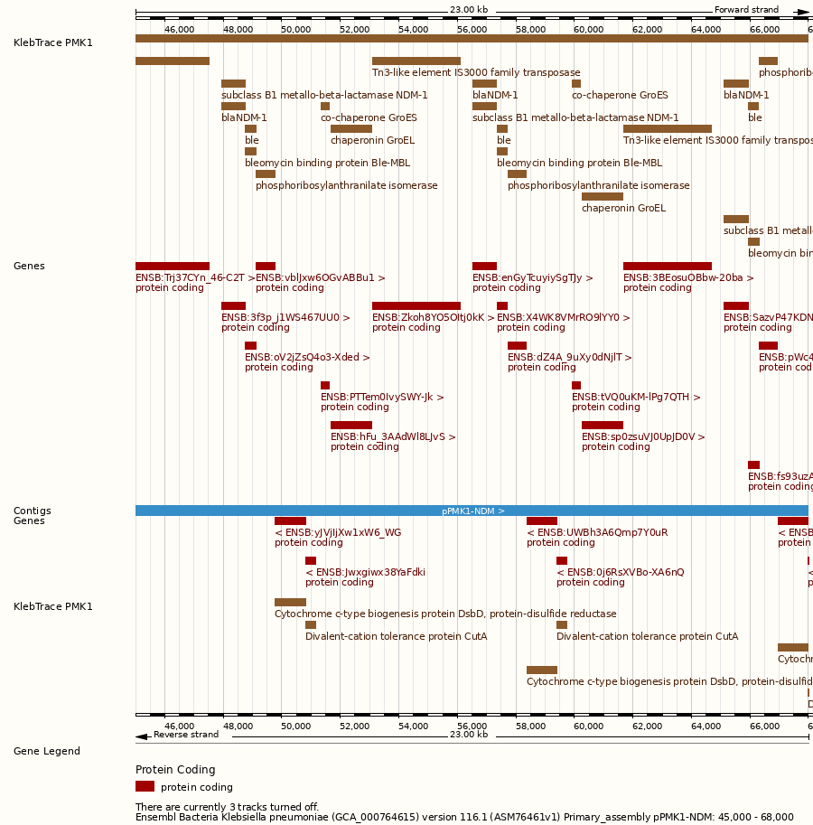
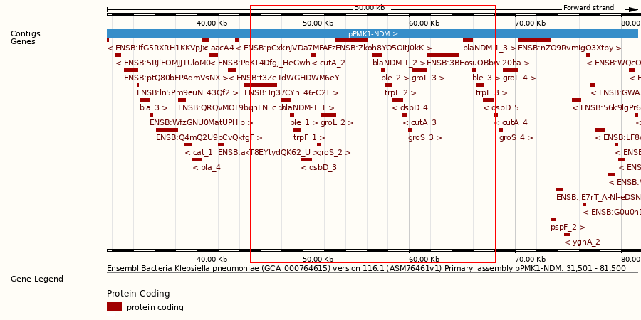
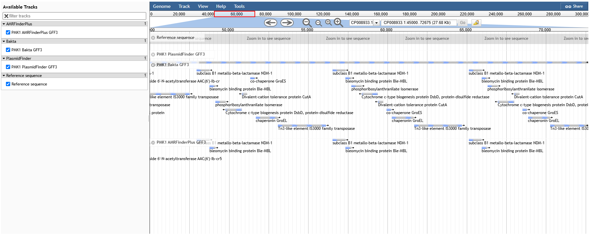

# KlebTrace: a reproducible annotation and data-integration pipeline for investigating carbapenem resistance in *Klebsiella pneumoniae*

#### Author: Chioma B Oselu (@Omabekee)

#### GitHub Code: [KlebTrace](https://github.com/Omabekee/KlebTrace)

I completed this project during my EMBL-UNESCO fellowship at EMBL-EBI, where I work on the AMR Portal. It asks what specialist annotation tools could add to Ensembl's bacterial genomes, using genomes from the AMR Portal whose laboratory results make it possible to check the annotation.

---

## Table of Contents
1. [Introduction](#1-introduction)
2. [Data](#2-data)
3. [Methods](#3-methods)
4. [Results](#4-results)
5. [Conclusion and Future Directions](#5-conclusion-and-future-directions)
6. [References](#references)

---

## 1. Introduction

*Klebsiella pneumoniae* is a common cause of hospital infections, and strains resistant to carbapenems leave very few treatment options. Carbapenem resistance in this species usually comes from an acquired carbapenemase gene such as *bla*KPC, *bla*NDM or *bla*OXA-48, often on a plasmid. It can also come from changes in the outer membrane porins OmpK35 and OmpK36, which reduce how much drug gets into the cell.

Ensembl Bacteria annotates its genomes with general-purpose tools: Prokka finds the genes, and other tools add non-coding RNAs and protein functions. This works across all bacteria, but it does not say which genes cause resistance, which plasmid contains them, or which strain a genome belongs to. Specialist tools such as AMRFinderPlus, Kleborate and PlasmidFinder give this information, and the question is whether Ensembl should use them.

The EMBL-EBI AMR Portal makes this question testable. It links laboratory antibiotic test results to the resistance genes in each isolate's genome, so the output of any annotation tool can be checked against the laboratory result.

### 1.1 Project Aim

To assess what specialist annotation tools could add to Ensembl's bacterial genome annotation, using *K. pneumoniae* genomes from the AMR Portal, and to build a reproducible pipeline that runs these tools and brings their results, the portal's resistance calls and the laboratory results together in one quality-checked database.

### 1.2 Objectives

1. **Value for Ensembl.** What do specialist tools add to Ensembl's own genome annotation, and how could these features be shown in the Ensembl browser?
2. **A reproducible pipeline.** Can the annotation be run as a pipeline that gives the same results every time, and loaded with the portal's calls and laboratory results into a database with automatic quality checks?
3. **Annotation agreement.** Do Bakta, AMRFinderPlus and Kleborate find the same resistance genes as the AMR Portal when they annotate the same genomes?
4. **Genotype and phenotype.** Do the genes found explain the laboratory result, and what explains resistant isolates with no carbapenemase in the portal?
5. **Genomic context.** Are the carbapenemase genes on plasmids or on the chromosome?

## 2. Data

### 2.1 AMR Portal

AMR Portal release 2026-07 was read from its Parquet files over HTTPS. It contains 4,824 *K. pneumoniae* isolates with a genome assembly and a meropenem test result. An isolate was called resistant if any meropenem test was resistant, and susceptible only if every test was susceptible.

For isolates with no carbapenemase in the portal, a stricter rule was used: the MIC had to be above 8 mg/L and the isolate had to be resistant under both the updated CLSI and EUCAST breakpoints. Of the 109 resistant isolates with no carbapenemase, 47 met this rule, and 37 of these had a GenBank assembly.

### 2.2 Study Genomes

Seven genomes were chosen so that each one tests a different question.

| Group | Assembly | Country | Year | Meropenem MIC (mg/L) | Portal carbapenemase |
|---|---|---|---|---|---|
| Carbapenemase, NDM | GCA_000764615.1 | Nepal | 2011 | resistant, no MIC | *bla*NDM-1 |
| Carbapenemase, KPC | GCA_049383265.1 | Brazil | 2023 | >128 | *bla*KPC-2 |
| Carbapenemase, OXA-48-like | GCA_043905605.1 | Tunisia | 2022 | >32 | *bla*OXA-48 |
| No carbapenemase in the portal | GCA_019928365.1 | Kenya | 2015 | >=16 | none |
| No carbapenemase in the portal | GCA_001182445.1 | Italy | 2011 | >32 | none |
| No carbapenemase, confirmed | GCA_000567225.2 | USA | 2012 | >32 | none |
| Susceptible control | GCA_900774885.1 | Saint Lucia | 2018 | susceptible, no MIC | none |

The assemblies were downloaded from ENA. Two of them, Nepal and Saint Lucia, are also in Ensembl Bacteria release 63, and their Ensembl annotation was the baseline for the tool assessment.

## 3. Methods

### 3.1 Selecting the Genomes

The AMR Portal Parquet files were queried with DuckDB in Python, reading only the needed columns over HTTPS. Carbapenemase genes were taken from the AMRFinderPlus element symbol, and porin point mutations were kept separate from acquired genes. One genome was picked for each carbapenemase family, preferring genomes that are in Ensembl. The seventh genome was added after the re-screen in section 3.5.

### 3.2 Annotation in Galaxy

The genomes were annotated on usegalaxy.org with a workflow that runs Bakta 1.9.4, AMRFinderPlus 4.2.7 (database 2026-05-15, organism *K. pneumoniae*, nucleotide input), PlasmidFinder 2.1.6, IntegronFinder 2.0.5 and ISEScan 1.7.2.3 on all genomes in one run. Kleborate is not on usegalaxy.org, so it was run locally with version 3.3.0b1, a pre-release and the version installed from Bioconda at the time of the run.

### 3.3 Pipeline and Database

The Galaxy workflow was rebuilt as a Nextflow pipeline using the same tool versions, run in Apptainer containers. The Bakta step reuses the Galaxy output, because Bakta's full database (39.4 GB) was too large for the workstation. The pipeline merges the outputs into one GFF3 file per genome, with standard feature types and the tool named on every feature. It then loads genomes, features, laboratory results and resistance calls from every source into an SQLite database, and runs nine quality checks, for example that every feature is on a sequence in the genome FASTA and that no identifier is repeated.

### 3.4 Tool Assessment Against Ensembl

Ensembl's GFF3 files for Nepal and Saint Lucia were downloaded from the Ensembl Genomes FTP site. Ensembl uses different sequence names from ENA (for example "pPMK1-NDM" instead of CP008933.1), so the KlebTrace files were renamed by matching sequence lengths, using the name in the FASTA header when two sequences had the same length. Each tool was then assessed on five points:

- **Added value:** each feature was matched to the Ensembl gene it overlaps on the same strand, and the two names were compared.
- **Accuracy:** for each source, resistance was counted as explained by an acquired carbapenemase, or by changes in both OmpK35 and OmpK36, and compared with the laboratory result for all seven genomes.
- **Fit for Ensembl:** output format, conversion needed, run time, database size, container, licence and recent releases.
- **Scorecard:** each tool was scored from 1 to 3 on six criteria.
- **Display:** the merged annotation for Nepal was uploaded to the Ensembl browser as a custom track.

### 3.5 Re-screen for Split Carbapenemase Genes

The 37 strictly resistant isolates with no carbapenemase in the portal were screened again. The 568 carbapenemase alleles in Kleborate's database were aligned to each assembly with minimap2, keeping matches of at least 50 bp and 95% identity. For each allele, the pieces found on different contigs were added together. A gene was called split when the pieces covered at least 95% of it and every piece ended at a contig edge, and partial when they covered less. For one split gene, public Illumina reads were mapped across the join between the two contig ends to confirm it. The genomes with no match were also run through Kleborate.

## 4. Results

### 4.1 Value for Ensembl

#### 4.1.1 Ensembl's Annotation

Ensembl annotates both genomes with Prokka: 5,553 protein-coding genes for Nepal and 5,817 for Saint Lucia. Bakta's genes match Ensembl's closely, with 99.5% at exactly the same coordinates, because Bakta and Prokka both use Prodigal to find genes. Many of Ensembl's genes have a name and a description, but nothing marks a gene as a resistance gene.

The new Ensembl site does not include Nepal. Only 3 of the 4,824 portal isolates are in it, all susceptible, so the release 63 archive of Ensembl Bacteria was used.

#### 4.1.2 What Each Tool Adds

**AMRFinderPlus** found no genes that Ensembl lacks: every resistance gene overlapped an Ensembl gene. What it adds is the correct identity of genes that Ensembl names loosely.

| AMRFinderPlus | Ensembl |
|---|---|
| *bla*CTX-M-15 | bla, described as CTX-M-1 |
| *bla*SHV-28 | bla, described as SHV-1 |
| *armA* | rmtB |
| *tet(D)* | tetA, class B |
| *qnrB1* | no name |

It also adds the drug class of each gene, point mutations in genes such as *gyrA* and the porins, and a flag for genes that are only partly present.

**PlasmidFinder** adds plasmid replicons, a feature type Ensembl does not show at all. They tell the user which plasmid family each resistance gene is on.

**Kleborate** adds species, sequence type, capsule type and virulence and resistance scores. These have no position on the genome, so they suit the genome summary page.

**Bakta** gives much the same genes as Ensembl, plus 10 to 11 small genes, origins of replication, CRISPR arrays and regulatory regions that Ensembl does not show.

#### 4.1.3 Accuracy

| Source | Carbapenemase found | Explains the laboratory result |
|---|---|---|
| AMR Portal calls | 3 of 7 genomes | 4 of 7 |
| AMRFinderPlus on the DNA | 5 of 7 | 6 of 7 |
| Kleborate | 4 of 7 | 5 of 7 |

AMRFinderPlus run on the DNA explained the most laboratory results. The difference from the portal comes from two genomes with a carbapenemase gene split across contigs (section 4.3.1).

#### 4.1.4 Fit for Ensembl

| | Bakta | AMRFinderPlus | Kleborate | PlasmidFinder |
|---|---|---|---|---|
| Output | GFF3 | TSV, needs conversion | one row per genome, no positions | TSV, needs conversion |
| Run time per genome | 37 min (Galaxy) | 3 min (Galaxy), about 1 min (pipeline) | 42 s | 21 to 31 s |
| Database | 39.4 GB | 246 MB | included | under 1 MB |
| Licence | GPL-3.0 | public domain | GPL-3.0 | Apache-2.0 |
| Scope | all bacteria | all bacteria | *K. pneumoniae* only | many bacteria |

#### 4.1.5 Scorecard and Recommendation

AMRFinderPlus scored 17 of 18 and Kleborate 10 of 18. Bakta and PlasmidFinder do not call resistance genes, so they were not scored on matching the laboratory results; both scored 12 of the remaining 15. The full scorecard is in [`docs/tool_assessment.md`](tool_assessment.md).

The recommendation is AMRFinderPlus run on the DNA as the main tool for resistance annotation in Ensembl, with PlasmidFinder alongside it for plasmid context. AMRFinderPlus covers all bacteria, has a small database, is already used by the AMR Portal, and gave the most accurate results here. Kleborate is useful for *K. pneumoniae* genome summaries, and Bakta would be worth considering if Ensembl rebuilds its bacterial gene sets.

#### 4.1.6 Display in the Ensembl Browser

<figure>
  
  <figcaption>Figure 1: The KlebTrace track (brown) under Ensembl's genes (red) on plasmid pPMK1-NDM, 45 to 68 kb, in the Ensembl Bacteria release 63 browser</figcaption>
</figure>

The KlebTrace track lines up with every Ensembl gene in the NDM region, and labels each one: *bla*NDM-1, *ble*, the GroES and GroEL chaperones and the IS3000 transposase. Ensembl's own view of the region next to it (Figure 2) names the CTX-M-15 gene only "bla".

<figure>
  
  <figcaption>Figure 2: Ensembl's own genes and gene names on pPMK1-NDM, 31.5 to 81.5 kb, without the KlebTrace track</figcaption>
</figure>

Each resistance gene appears twice in the KlebTrace track, once from Bakta and once from AMRFinderPlus. A short proposal for how resistance features could be shown in Ensembl, with the resistance details attached to the existing gene, is in [`docs/representation_note.md`](representation_note.md).

### 4.2 A Reproducible Pipeline and Database

The Nextflow pipeline gave AMRFinderPlus and PlasmidFinder tables identical to the Galaxy outputs, line for line, for all seven genomes. It ran in 13 min 54 s for all seven genomes on a 4-CPU workstation, using 0.5 GB of memory. In Galaxy, the same three tools on one genome (Nepal) took about 41 minutes of run time, 37 of them for Bakta, which the pipeline reuses from Galaxy. Without Bakta, Galaxy took 3.5 minutes for one genome and the pipeline 14 minutes for seven, about 2 minutes each, with Kleborate, the merge, the database and the quality checks added. AMRFinderPlus was slower in the pipeline (8 minutes for Nepal against 3 in Galaxy), probably because each task had only 2 CPUs. The main gain is that one command runs every step on every genome, with versions fixed and outputs checked. The database contains 7 genomes, 777 sequences, 41,116 features and resistance calls from four sources, so a single query shows each genome's carbapenemase genes from every source next to its laboratory result.

The quality checks gave 50 passes, 13 warnings and no failures. The warnings flag real problems in the data: the partial and unnamed carbapenemase genes in Kenya and Italy, and duplicated genes in the Tunisian genome. A fault in the pipeline itself, a step that was not given all its input files, was logged as a GitHub issue and fixed with a new test that checks every script call in the pipeline.

### 4.3 Other Findings

#### 4.3.1 An Independent Check of the AMR Portal's Calls

Annotating the portal's genomes again with other tools gives an independent check of its resistance calls: it shows where they match the laboratory result, where they fall short, and what extra information other tools add. The re-annotation agreed with the portal on carbapenemase status for 5 of the 7 genomes. In the other two, the portal reports no carbapenemase but the genome has one.

| Genome | Portal | AMRFinderPlus (DNA) | Kleborate | Split-gene screen |
|---|---|---|---|---|
| Kenya | none | *bla*OXA, closest OXA-232 | OXA-232? | OXA-232, split in 2 pieces |
| Italy | none | *bla*KPC, partial at contig end | none | KPC-2, split in 3 pieces |

In Kenya, OXA-232 is split between the two ends of a 6.1 kb contig. 291 sequencing reads cross the join between the two ends, which shows that the contig is a small circular plasmid with the gene intact, and this contig has about 5.5 times the read depth of the large contigs, as expected for a small plasmid with several copies per cell. PlasmidFinder found a ColKP3 replicon on the same contig (JAGYDM010000061.1), the plasmid type known to spread OXA-232, which supports this from a separate line of evidence. In Italy, the whole KPC-2 gene is present at 100% identity in three pieces on three contigs, but no reads were available to confirm it.

Every call in the portal's data is labelled as made from predicted proteins, while the Galaxy run searched the DNA. A gene broken across contigs does not give a complete protein, so a protein search can miss it; Bakta did not predict a gene at Kenya's OXA-232 either. Across the 37 strictly resistant isolates with no carbapenemase in the portal, 2 have a whole carbapenemase gene split across contigs and 3 more have part of one. The portal's calls also miss some porin changes, such as the OmpK35 stop codon in Kenya.

#### 4.3.2 Genomic Context

In Nepal, the only complete genome in the set, *bla*NDM-1 is on the plasmid pPMK1-NDM (304,526 bp) in three copies. Each copy is part of an identical block of eight genes (*bla*NDM-1, *ble*, *trpF*, *dsbD*, *cutA*, *groES*, *groL* and an IS3000 transposase), and the block repeats every 8,588 bp. The same plasmid contains CTX-M-15, OXA-1, a class 1 integron, *armA*, and mercury and tellurium resistance genes. In Kenya, OXA-232 is on a small ColKP3 plasmid. The other genomes are in many pieces, so the location of their genes cannot be confirmed.

<figure>
  
  <figcaption>Figure 3: The three NDM-1 copies on plasmid pPMK1-NDM (45 to 72 kb) in JBrowse, with the Bakta, AMRFinderPlus and PlasmidFinder tracks</figcaption>
</figure>

#### 4.3.3 An Unexplained Resistant Genome

GCA_000567225.2 has a meropenem MIC above 32 mg/L, but no source found a carbapenemase or an extended-spectrum beta-lactamase. Its only change is a truncated OmpK36, which does not usually give resistance this high on its own.

#### 4.3.4 Resistance and Virulence Together

The Tunisian OXA-48 genome also has the aerobactin genes, *rmpA*, *rmpA2* and *peg-344*, which are linked to hypervirulent *K. pneumoniae*, and Kleborate gives it the highest virulence score in the set. In the same genome, contigs 130 to 147 repeat sequence already present earlier in the assembly, so many of its genes are counted twice, in KlebTrace and in the portal.

## 5. Conclusion and Future Directions

This project assessed four annotation tools against Ensembl's own annotation of *K. pneumoniae*, using AMR Portal genomes whose laboratory results made it possible to check the tools' calls. Ensembl already has nearly all the resistance genes, but often under a loose name and with nothing to say what they do. AMRFinderPlus run on the DNA would add the correct gene names, drug classes and point mutations, and it explained the most laboratory results (6 of 7). PlasmidFinder would add plasmid replicons, which Ensembl does not show today. A custom track in the Ensembl browser showed that the two can be lined up with Ensembl's genes.

The work runs as a reproducible Nextflow pipeline that gave the same results as the Galaxy workflow and loads everything into one quality-checked database. Its checks caught real problems in the data. Along the way, the re-annotation showed that carbapenemase genes split across contigs are missing from the portal's calls in two of the seven genomes.

The study has limits. It used only seven genomes, only two of which are in Ensembl, and the split KPC-2 in Italy could not be confirmed with reads. The reason the portal misses split genes was inferred from its data, where every call is labelled as made from predicted proteins; the portal's own pipeline was not examined. One resistant genome remains unexplained.

Future work includes:

- merging the Bakta and AMRFinderPlus features into one feature per gene for display in Ensembl;
- building a pangenome of the seven genomes with Panaroo, to see which genes all of them share and where the carbapenemase genes fall;
- finding biosynthetic gene clusters with antiSMASH and comparing them with Kleborate's virulence loci, such as yersiniabactin and aerobactin;
- summarising gene functions into pathways with eggNOG-mapper, which applies the EggNOG database that Ensembl already uses;
- running the pipeline on a cluster, including the Bakta step with its full database;
- confirming split genes with sequencing reads or long-read assemblies;
- looking for other causes of resistance in GCA_000567225.2, such as efflux pumps or AmpC enzymes.

---

## References

1. Carattoli, A., Zankari, E., García-Fernández, A., Voldby Larsen, M., Lund, O., Villa, L., Møller Aarestrup, F. & Hasman, H. (2014). In silico detection and typing of plasmids using PlasmidFinder and plasmid multilocus sequence typing. *Antimicrobial Agents and Chemotherapy*, 58(7), 3895-3903. https://doi.org/10.1128/AAC.02412-14
2. Di Tommaso, P., Chatzou, M., Floden, E.W., Prieto Barja, P., Palumbo, E. & Notredame, C. (2017). Nextflow enables reproducible computational workflows. *Nature Biotechnology*, 35(4), 316-319. https://doi.org/10.1038/nbt.3820
3. EMBL-EBI AMR Portal. Release 2026-07. https://www.ebi.ac.uk/amr
4. Feldgarden, M., Brover, V., Gonzalez-Escalona, N., Frye, J.G., Haendiges, J., Haft, D.H., Hoffmann, M., Pettengill, J.B., Prasad, A.B., Tillman, G.E., Tyson, G.H. & Klimke, W. (2021). AMRFinderPlus and the Reference Gene Catalog facilitate examination of the genomic links among antimicrobial resistance, stress response, and virulence. *Scientific Reports*, 11, 12728. https://doi.org/10.1038/s41598-021-91456-0
5. Lam, M.M.C., Wick, R.R., Watts, S.C., Cerdeira, L.T., Wyres, K.L. & Holt, K.E. (2021). A genomic surveillance framework and genotyping tool for *Klebsiella pneumoniae* and its related species complex. *Nature Communications*, 12, 4188. https://doi.org/10.1038/s41467-021-24448-3
6. Li, H. (2018). Minimap2: pairwise alignment for nucleotide sequences. *Bioinformatics*, 34(18), 3094-3100. https://doi.org/10.1093/bioinformatics/bty191
7. Néron, B., Littner, E., Haudiquet, M., Perrin, A., Cury, J. & Rocha, E.P.C. (2022). IntegronFinder 2.0: identification and analysis of integrons across Bacteria, with a focus on antibiotic resistance in *Klebsiella*. *Microorganisms*, 10(4), 700. https://doi.org/10.3390/microorganisms10040700
8. Schwengers, O., Jelonek, L., Dieckmann, M.A., Beyvers, S., Blom, J. & Goesmann, A. (2021). Bakta: rapid and standardized annotation of bacterial genomes via alignment-free sequence identification. *Microbial Genomics*, 7(11), 000685. https://doi.org/10.1099/mgen.0.000685
9. Seemann, T. (2014). Prokka: rapid prokaryotic genome annotation. *Bioinformatics*, 30(14), 2068-2069. https://doi.org/10.1093/bioinformatics/btu153
10. The Galaxy Community (2024). The Galaxy platform for accessible, reproducible, and collaborative data analyses: 2024 update. *Nucleic Acids Research*, 52(W1), W83-W94. https://doi.org/10.1093/nar/gkae410
11. Xie, Z. & Tang, H. (2017). ISEScan: automated identification of insertion sequence elements in prokaryotic genomes. *Bioinformatics*, 33(21), 3340-3347. https://doi.org/10.1093/bioinformatics/btx433
12. Yates, A.D., Allen, J., Amode, R.M., Azov, A.G., Barba, M., Becerra, A., ... & Flicek, P. (2022). Ensembl Genomes 2022: an expanding genome resource for non-vertebrates. *Nucleic Acids Research*, 50(D1), D996-D1003. https://doi.org/10.1093/nar/gkab1007
