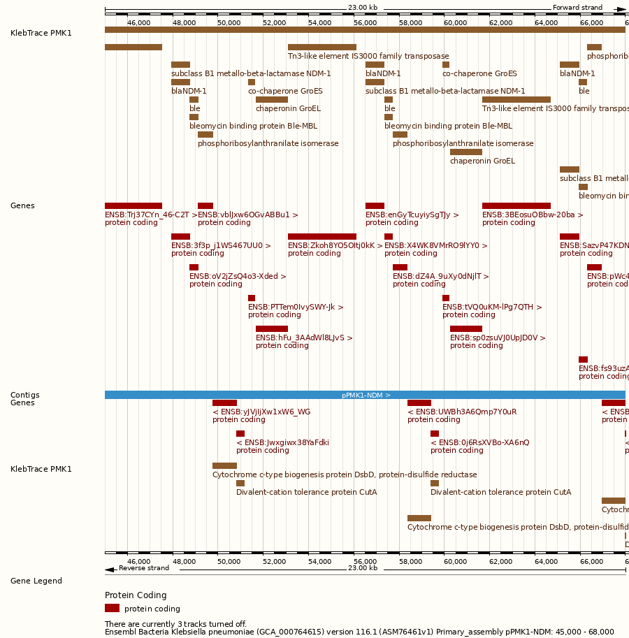
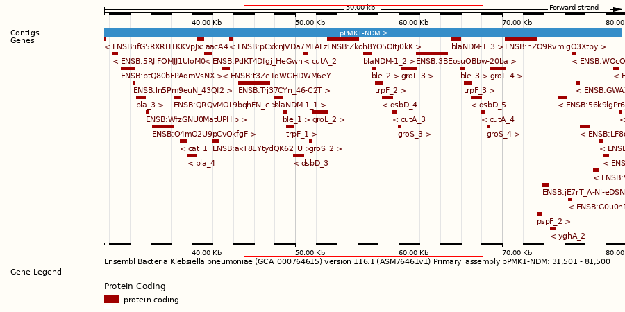

# Tool assessment

What each tool adds beyond Ensembl Bacteria's own annotation of *Klebsiella pneumoniae*, how accurate its resistance calls are against the laboratory result, and how easily Ensembl could use it.

## Baseline: Ensembl's annotation

Two of the seven study genomes are in Ensembl Bacteria (release 63): GCA_000764615.1 (PMK1, Nepal, complete genome with four plasmids) and GCA_900774885.1 (the susceptible control, 119 contigs). Their GFF3 files were downloaded from the Ensembl Genomes FTP site into `data/ensembl/` (not stored in this repository).

| | GCA_000764615.1 | GCA_900774885.1 |
|---|---|---|
| Ensembl gene build | 2022-12-Prokka (source MGnify) | 2022-12-Prokka (source MGnify) |
| Protein-coding genes | 5,553 | 5,817 |
| Non-coding RNA genes (all biotype ncRNA) | 180 | 159 |
| Sequence names | Chromosome, pPMK1-A, pPMK1-B, pPMK1-C, pPMK1-NDM | submitter contig names (ERS2179090SCcontig000001 ...) |

Ensembl's genes come from Prokka. Gene names come from Prokka's databases: many genes have a name and a description, and Prokka numbers repeated names (blaNDM-1_1, blaNDM-1_2, blaNDM-1_3).

**Sequence names differ.** KlebTrace uses ENA accessions (CP008933.1), while Ensembl uses "Chromosome" and the plasmid names for PMK1, and the submitter's contig names for GCA_900774885.1. `scripts/to_ensembl_seqids.py` renames a KlebTrace GFF3 to Ensembl's names by matching sequence lengths, using the name in the FASTA header when two sequences have the same length. All 5 and all 119 sequences matched (`results/ensembl_tracks/*.seqid_map.tsv`).

## Added value

From `scripts/assess_added_value.py` (`results/tool_assessment/*.added_value*.tsv`). Each feature is matched to the Ensembl gene it overlaps on the same strand.

| Tool | Genome | Features | Ensembl gene, same name | Ensembl gene, other or no name | No Ensembl gene | Not a gene in Ensembl's model |
|---|---|---|---|---|---|---|
| AMRFinderPlus | PMK1 | 69 | 21 | 44 | 0 | 4 (point mutations) |
| AMRFinderPlus | GCA_900774885.1 | 36 | 11 | 25 | 0 | 0 |
| PlasmidFinder | PMK1 | 6 | - | - | - | 6 (replicons) |
| PlasmidFinder | GCA_900774885.1 | 5 | - | - | - | 5 (replicons) |
| Bakta (CDS) | PMK1 | 5,573 | 2,384 | 3,179 | 10 | 0 |
| Bakta (CDS) | GCA_900774885.1 | 5,833 | 2,419 | 3,403 | 11 | 0 |

**AMRFinderPlus: correct names and resistance classes for genes Ensembl already has.** Every AMRFinderPlus gene in both genomes sits on an Ensembl gene, so it adds no new genes. What it adds is the right identity. Ensembl names all three *bla*NDM-1 copies correctly, but many other resistance genes carry a generic or wrong name:

| AMRFinderPlus | Ensembl (Prokka) name and description |
|---|---|
| *bla*CTX-M-15 | bla, "Beta-lactamase CTX-M-1" (wrong allele) |
| *bla*SHV-28 | bla, "Beta-lactamase SHV-1" (wrong allele) |
| *armA* | rmtB, "16S rRNA (guanine(1405)-N(7))-methyltransferase" (a different methyltransferase) |
| *tet(D)* | tetA, "Tetracycline resistance protein, class B" (a different class) |
| *aac(6')-Ib-cr5* | aacA4, "Aminoglycoside N(6')-acetyltransferase type 1" (misses the fluoroquinolone-modifying cr variant) |
| *qnrB1* | no name, "Pentapeptide repeat protein" |
| *sul1*, *aadA2*, *catB3*, *catA1* | folP, ant1, cat, cat (generic family names) |

AMRFinderPlus also adds the drug class and subclass (CARBAPENEM, CEPHALOSPORIN and so on), the method (exact allele, partial, partial at a contig end), and point mutations (*gyrA*, *parC*, *ramR*, porins), none of which are in Ensembl's gene model. Some names differ only by convention (the *sil* and *pco* metal-resistance genes are *cus* and *cop* in Ensembl).

**PlasmidFinder: a feature type Ensembl does not have.** Ensembl has no plasmid replicon features, so the 11 replicons (IncHI1B and IncFIB(pNDM-Mar) on pPMK1-NDM, for example) are all new. They tell a reader which plasmid family carries each resistance gene.

**Kleborate: genome-level facts with no coordinates.** Species, sequence type, capsule and O locus, virulence and resistance scores. These have no place in a gene track, but they could be genome metadata on the Ensembl species page.

**Bakta: broadly the same genes as Ensembl, plus features Ensembl lacks.** Bakta finds 5,573 CDS on PMK1 against Ensembl's 5,553 protein-coding genes, and 99.5% of Bakta's CDS have exactly the coordinates of an Ensembl gene (5,544 of 5,573; 99.6% for GCA_900774885.1). Both build on Prodigal gene prediction, which explains the close match. Bakta adds 10 to 11 small genes that Ensembl lacks (*ypdK*, *ypfM*, *pqqA*, *pheM* and unnamed small ORFs), and feature types Ensembl does not show: origins of replication, CRISPR arrays with their repeats and spacers, 57 regulatory regions, and separate tRNA, rRNA, tmRNA and ncRNA types (Ensembl lists 180 non-coding RNA genes, all of biotype ncRNA). Bakta also attaches database cross-references (UniRef, RefSeq, COG) to most genes.

## Accuracy

From `scripts/assess_accuracy.py` (`results/tool_assessment/accuracy*.tsv`), on all seven genomes. Resistance counts as explained by an acquired carbapenemase, or by changes in both OmpK35 and OmpK36.

| Source | Genomes | Carbapenemase found | Explains the laboratory result |
|---|---|---|---|
| AMR Portal calls (AMRFinderPlus on proteins) | 7 | 3 | 4 of 7 |
| AMRFinderPlus on the nucleotide sequence | 7 | 5 | 6 of 7 |
| Kleborate | 7 | 4 | 5 of 7 |
| Split-gene screen (portal-negative isolates only) | 3 | 2 | 2 of 2 with a carbapenemase |

- **GCA_019928365.1 (Kenya):** OXA-232 split across the two ends of a plasmid contig. Found by AMRFinderPlus (unnamed `blaOXA`), Kleborate (`OXA-232?`) and the split-gene screen; not in the portal's calls. Bakta and Ensembl-style gene calling miss it as well (no CDS there).
- **GCA_001182445.1 (Italy):** KPC-2 split across three contigs. Found by AMRFinderPlus (partial `blaKPC`) and the split-gene screen; missed by Kleborate and the portal.
- **GCA_000567225.2:** no carbapenemase in any source, and only OmpK36 is changed. No source explains its MIC above 32 mg/L.
- The portal's calls also miss porin changes that AMRFinderPlus on DNA finds (the OmpK35 stop codon in Kenya, the OmpK35 frameshift in Brazil).

## Fit for Ensembl

| | Bakta | AMRFinderPlus | Kleborate | PlasmidFinder |
|---|---|---|---|---|
| Output | GFF3, GenBank, EMBL, TSV | TSV | TSV (one row per genome) | TSV, JSON |
| Conversion for Ensembl | none (GFF3 already); rename sequences | TSV to GFF3 (`merge_annotations.py`) | none possible as a track; metadata only | TSV to GFF3 (`merge_annotations.py`) |
| Run time per genome (workstation, 2 CPUs) | 10 to 30 min in Galaxy (estimate from the Phase 2 guide; not rerun) | about 1 min (8 min for the 6 Mb complete genome) | 42 s | 21 s |
| Database | 39.4 GB full, 1.5 GB light | 246 MB indexed | bundled | under 1 MB |
| Container (quay.io/biocontainers) | 426 MB | 313 MB | 1.5 GB | 373 MB |
| Licence | GPL-3.0 | public domain (US government work) | GPL-3.0 | Apache-2.0 |
| Maintenance (checked 4 November 2026) | active; latest release v1.12.2, 11 October 2026 (Galaxy has 1.9.4) | active; latest release 4.2.7, January 2026; database updated 2026-05-15 | active; latest release v3.3.0b1, September 2026 (beta) | active; tool updated October 2026; database last updated November 2025 (Galaxy uses December 2023) |
| Organism scope | all bacteria | all bacteria, with species-specific point mutations | *K. pneumoniae* species complex only | Enterobacterales and Gram-positive replicons |

Versions and sizes are those used in this project; container sizes are compressed. Licences were read from each project's repository.

## Scorecard

Each criterion scored 1 (weak) to 3 (strong) for use in Ensembl Bacteria.

| Criterion | Bakta | AMRFinderPlus | Kleborate | PlasmidFinder |
|---|---|---|---|---|
| Added value over Ensembl | 2: same genes, extra feature types and cross-references | 3: correct allele names, drug classes, point mutations, partial genes | 2: genome-level typing, no coordinates | 3: a feature type Ensembl lacks |
| Accuracy against the laboratory result | n/a (not a resistance tool) | 3: explains 6 of 7 | 2: explains 5 of 7, misses Italy | n/a |
| Output fit (GFF3, coordinates) | 3 | 2: needs conversion | 1: no coordinates | 2: needs conversion |
| Resources | 1: 39.4 GB database, slowest step | 3 | 2: large container | 3 |
| Scope | 3: all bacteria | 3: all bacteria | 1: one species complex | 2 |
| Licence and maintenance | 3 | 3 | 2: current release is a beta | 2: database updates are infrequent |
| **Total (of 18, or 15 where accuracy does not apply)** | **12 of 15** | **17 of 18** | **10 of 18** | **12 of 15** |

## Recommendation

1. **AMRFinderPlus, run on the nucleotide sequence, is the strongest candidate** for adding resistance annotation to Ensembl Bacteria. It is already the tool behind the AMR Portal, it covers all bacteria, its database is small, and its calls explain the most laboratory results here. Running it on the DNA, not on predicted proteins, recovers genes split at contig ends, which the portal's protein-based calls miss (2 of 7 genomes here, and 5 of 37 strictly resistant portal-negative isolates in the wider screen). Its output needs a GFF3 conversion, which `merge_annotations.py` already does.
2. **PlasmidFinder** adds a feature type Ensembl does not have, at almost no cost. It is a natural companion to AMRFinderPlus, because it shows which plasmid family carries each resistance gene.
3. **Kleborate** is valuable for *K. pneumoniae* but its results (species, sequence type, virulence score) suit the genome summary page, not a gene track, and it is species-specific.
4. **Bakta** gives much the same genes as Ensembl's Prokka-based build, with richer feature types and cross-references, but its 39.4 GB database makes it the most expensive tool. It would be worth considering if Ensembl rebuilds its bacterial gene sets, not as an add-on.

## Prototype display

The merged KlebTrace annotation for PMK1, renamed to Ensembl's sequence names (`results/ensembl_tracks/GCA_000764615.1.ensembl_names.gff3`), was uploaded as a custom track in the Ensembl Bacteria release 63 browser and viewed at pPMK1-NDM:45,000-68,000.

<figure>
  
  <figcaption>Figure 1: The KlebTrace track (brown) under Ensembl's genes (red) on plasmid pPMK1-NDM, 45,000 to 68,000. Forward-strand genes are above the blue plasmid bar and reverse-strand genes below it.</figcaption>
</figure>

- **The track lines up with Ensembl's genes.** Every KlebTrace feature sits directly over an Ensembl gene, on the same strand, across the three repeated blocks. The renaming of the sequences worked, and the coordinates agree.
- **KlebTrace adds names and meaning.** Ensembl's genes here are labelled only by their Ensembl IDs (ENSB:...) unless you click them. The KlebTrace track labels each one: blaNDM-1 (from AMRFinderPlus) above "subclass B1 metallo-beta-lactamase NDM-1" (from Bakta), ble, the GroES and GroEL chaperones, and the Tn3-family IS3000 transposase at the end of each block.
- **Each resistance gene shows twice in the track,** once from Bakta and once from AMRFinderPlus. For a display in Ensembl, one merged feature per gene would be clearer.

<figure>
  
  <figcaption>Figure 2: Ensembl's own genes and gene names on pPMK1-NDM, 31,500 to 81,500, without the KlebTrace track.</figcaption>
</figure>

Figure 2 shows the naming problem described under Added value. Ensembl names the three NDM copies correctly (blaNDM-1_1, _2 and _3), but the genes just before them are bla_3 (described as "Beta-lactamase CTX-M-1"; AMRFinderPlus: blaCTX-M-15), bla_4 ("Beta-lactamase OXA-1"; AMRFinderPlus: blaOXA-1), cat_1 (catB3) and aacA4 (aac(6')-Ib-cr5). A reader of Ensembl alone would not know that this plasmid also carries an extended-spectrum beta-lactamase.

**How to open this view.** In November 2026, bacteria.ensembl.org redirects to the new Ensembl site, and the new site does not hold PMK1: its FTP area (https://ftp.ebi.ac.uk/pub/ensemblorganisms/) has GCA_900774885.1 (the susceptible control, annotated with Prokka) but neither GCA_000764615.1 nor its RefSeq copy GCF_000764615.1. The assembly is still current at ENA and NCBI, so the reason is not a withdrawn or replaced assembly; it is not stated in the files checked. Of the 4,824 *K. pneumoniae* isolates in AMR Portal release 2026-07 with an assembly and a meropenem result, 7 were in Ensembl Bacteria release 63 and only 3 are in the new Ensembl site (checked against its `species.json`, 16,205 assemblies, 5 October 2026). All three are susceptible and carry no carbapenemase (GCA_900774885.1, GCA_900092915.2, GCA_900776505.1), so no genome in the new site could show a carbapenemase region. The release 63 archive of Ensembl Bacteria still has PMK1:

1. Open the species page, https://jun2026-bacteria.ensembl.org/Klebsiella_pneumoniae_gca_000764615 (the species name is the second column of `species_EnsemblBacteria.txt`, with a capital K). The old address, https://bacteria.ensembl.org/Klebsiella_pneumoniae_gca_000764615, also redirects there.
2. Click **Example region** to open the region view.
3. In the location box at the top of the region view, type `pPMK1-NDM:45000-68000` and press **Go**.
4. In the left-hand menu, click **Custom tracks**, choose the GFF3 file and the GFF3 format, and click **Add data**.
